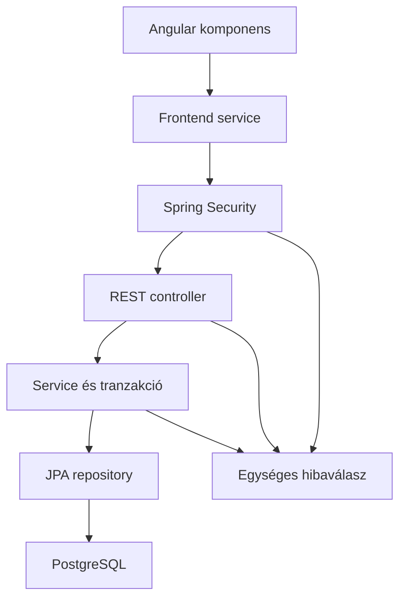
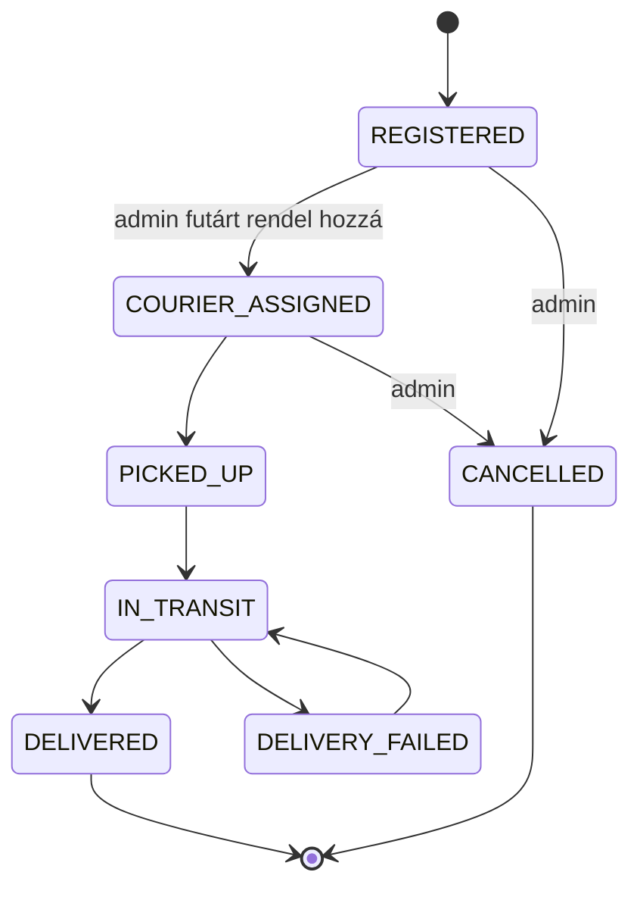

# Architektúra

## Kérések útja

Az Angular komponensek a frontend service-eken keresztül hívják a REST API-t. A Spring Security a controller előtt ellenőrzi a munkamenetet, az útvonalhoz tartozó szerepkört és a módosító kérések CSRF-tokenjét. A controller validálja a DTO-t és átadja a bejelentkezett felhasználó email-címét a service-nek. A service az adatbázisban tárolt aktuális aktivitást, szerepkört és tulajdonosi kapcsolatot is ellenőrzi; ezt nem helyettesíti a frontend guard.

## Adatmodell

| Entitás | Felelősség és kapcsolatok |
|---|---|
| `User` | Email, jelszóhash, név, telefon, szerepkör, aktivitás; opcionális mentett `Address` |
| `Address` | Ország, irányítószám, település, utca, házszám, opcionális ajtó |
| `Shipment` | Feladó, opcionális futár, két cím, címzettnév, követési szám, státusz, időbélyegek |
| `Parcel` | Küldeményhez tartozó súly, leírás és törékenység |
| `TrackingEvent` | Küldemény állapottörténete, változtató felhasználó, leírás és időpont |

Egy felhasználó saját címrekordot kap. Két felhasználó címszövege lehet azonos: az `address_id` egyedisége a rekordazonosítóra vonatkozik. A küldemény létrehozása új címrekordokat ment, ezért a profil címmódosítása nem módosítja a korábbi feladási/kézbesítési címeket.

## Session és CSRF

1. A kliens lekéri a `/api/auth/csrf` végpontot. A válasz tartalmazza a tokent és a használandó fejléc nevét; a böngésző munkamenetcookie-t kap.
2. A login POST elküldi a hitelesítő adatokat, a CSRF-fejlécet és a cookie-t.
3. Sikeres bejelentkezéskor a backend cseréli a munkamenet azonosítóját és elmenti az autentikációt. A korábbi CSRF-token érvényét veszti.
4. A módosító műveletek előtt a frontend friss tokent kér. A kéréseknél `withCredentials: true` engedi a session cookie használatát.
5. Oldalfrissítés után az `auth.service.ts` a `/api/auth/me` alapján állítja vissza a felhasználói állapotot. A route guard megvárja ennek befejezését.
6. Kijelentkezéskor a backend érvényteleníti a sessiont, törli a `JSESSIONID` cookie-t; a frontend kiüríti az aktuális felhasználót.

A jelszót BCrypt hash-ként tároljuk. A frontend `isLoggedIn` jellegű állapota csak a megjelenítést irányítja; a szerver a hozzáférés döntési pontja.

## Tranzakciók és ütközések

- A feladás egy tranzakcióban menti a címeket, a küldeményt, a csomagokat és a kezdeti előzményt.
- Futárhozzárendelés és státuszváltás a küldemény rekordját írási zárral olvassa. A státusz és az új előzmény egy tranzakció része.
- Az admin hozzáférésmódosításai zárolják az adminrekordokat, majd a célszemélyt. Ez a saját hozzáférés tiltásával együtt megakadályozza, hogy két admin párhuzamosan egymást letiltva admin nélkül hagyja az alkalmazást.
- Az előzmények `occurredAt`, majd `id` szerint növekvő sorrendben érkeznek.

## Státuszváltások

A futár csak saját hozzárendelt küldeményen léphet tovább. Törlést kizárólag admin kezdeményezhet. A `COURIER_ASSIGNED` állapotot a hozzárendelési művelet állítja be; nem szabad külön státusz-PATCH-csel előállítani.
